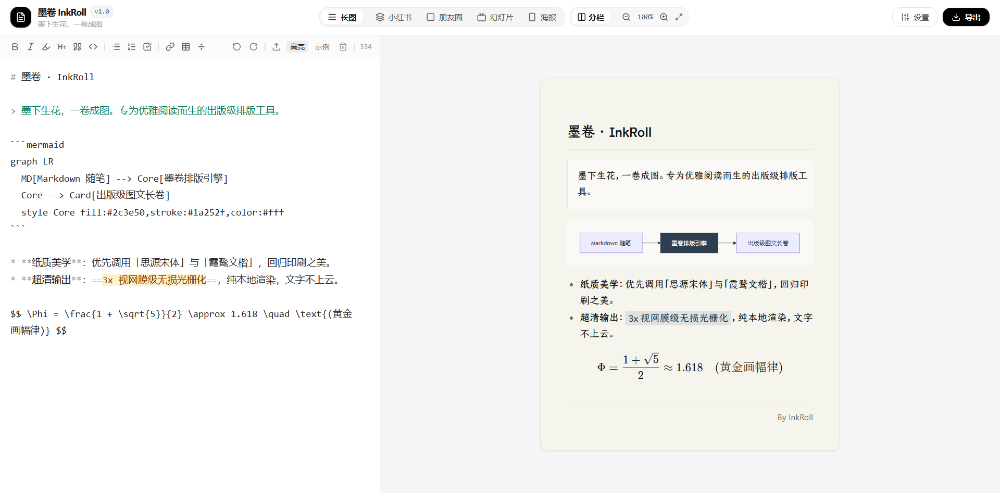

<div align="center">

# 墨卷 · InkRoll

<p align="center">
  <strong>墨下生花，一卷成图</strong>
</p>

<p align="center">
  <a href="./LICENSE"></a>
  <a href="https://bun.sh"></a>
  <a href="https://react.dev"></a>
  <a href="https://www.typescriptlang.org/"></a>
</p>

<p align="center">
  <a href="https://iroha3.github.io/inkroll/"><strong>✨ 在线使用网页版</strong></a>
</p>

<p align="center">
  
</p>

<p align="center">
  <sub>专为优雅阅读而生的 Markdown 卡片与长图排版工具</sub>
</p>

</div>

---

## 为什么选择墨卷？

日常在社交媒体、知识库或社群分享技术笔记与随笔思考时，普通的截图往往充满生硬的黑体、断行错乱与刺眼的冷白背景。

**墨卷 (InkRoll)** 汲取传统纸质出版物美学与现代排版设计，将纯文本 Markdown 转化为充满质感的图文卡片与长图。

---

## 核心特性

| 特性 | 说明 |
| :--- | :--- |
| **超清长图导出** | 高精度光栅化渲染，3x 视网膜级超清 PNG 输出，支持一键复制到系统剪贴板。 |
| **多场景画幅适配** | 内置小红书黄金图文、朋友圈与九宫格、幻灯片与宽屏、无限延展卷轴长图，契合主流平台画幅。 |
| **全离线公式与图表** | 全离线 KaTeX 数学公式渲染 + Mermaid 流程图与时序图解析支持。 |
| **纯本地离线隐私** | 解析与渲染均在浏览器本地完成，内容不上云，纯粹、安全且私密。 |
| **精细的排版控制** | 支持实时调节字号、行距、内边距、圆角与主题，提供优雅的水印签名配置。 |

---

## 排版主题

墨卷内置针对不同阅读场景精细微调的 4 款主题：

* **纯白**：极简干净、现代高可读性的通用纯白排版。
* **黛绿**：深沉雅致的东方古典色调。
* **柔蓝**：轻快明亮、现代年轻化的颜色主题。
* **暗黑**：专为夜间与代码块干货打造的深色视界。

---

## 本地构建

```sh
# 安装依赖
bun install

# 启动本地 Web 开发服务 (http://localhost:5173)
bun run dev:web

# 构建生产版本
bun run build:web
```

---

## 许可证

本项目基于 **AGPL-3.0** 开源许可证分发，核心排版引擎模块遵循 **MPL-2.0** 许可证。详情请参阅 [LICENSE](./LICENSE)。

---

## 致谢

* 🎨 **[tw93/Kami](https://github.com/tw93/kami)**：墨卷的黛绿主题深受 tw93 探索的启发。在此致敬！
* 📐 **[KaTeX](https://katex.org/)** & **[markdown-it](https://github.com/markdown-it/markdown-it)**：提供强大的底层数学公式与标记语言解析基石。
* 📊 **[Mermaid](https://mermaid.js.org/)**：为卡片排版提供优雅的图表渲染支持。
