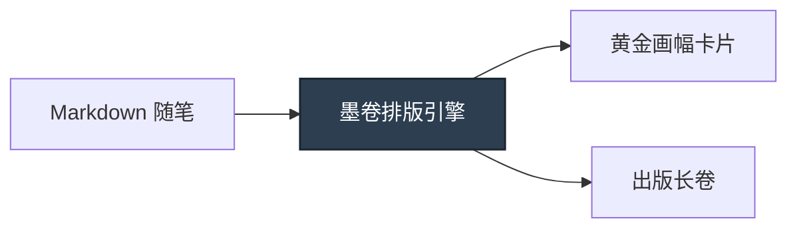

# 墨卷 · InkRoll

> "字如落墨，卷似云舒。" —— 专为优雅阅读而生的排版画卷

日常琐碎的信息如流沙，唯有经过排版沉淀的文字，才拥有穿透屏幕的温润质感。**墨卷 (InkRoll)** 将纯文本 Markdown 转化为具有纸质出版物美感的图文卡片与长图。

---

### 🖋️ 墨色排版法则

* **克制呼吸**：行距舒展、边缘适度留白，让长篇阅读不再疲惫。
* **衬线韵律**：优先调用「思源宋体」与「霞鹜文楷」，回归印刷排版之美。
* **超清输出**：==3x 视网膜级无损光栅化==，告别截图模糊噪点。



### 📐 美学与秩序的交汇

排版的骨骼是尺度与比例，正如经典版心的黄金律：

$$ \Phi = \frac{1 + \sqrt{5}}{2} \approx 1.618 \quad \text{(黄金分割率)} $$

```typescript
// 纯本地离线光栅化，内容绝不上云
const card = await Inkroll.render(markdown, {
  theme: 'forest-paper', // 黛绿东方色调
  scale: 3,              // 视网膜超清光栅
});
```

> **墨下生花，一卷成图。**  
> 在信息洪流中，让每一次记录都拥有实体书卷般的从容。
